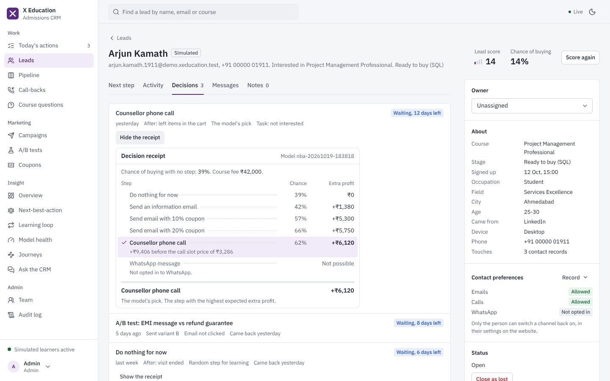
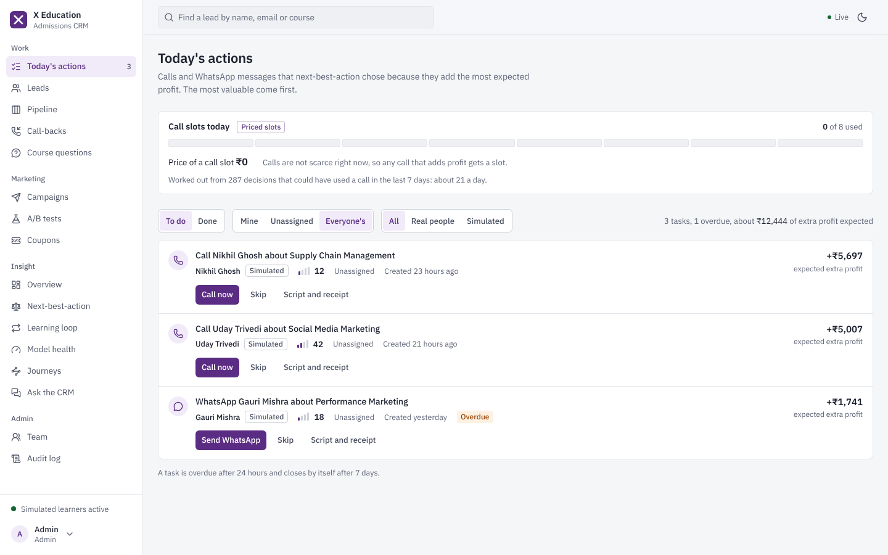
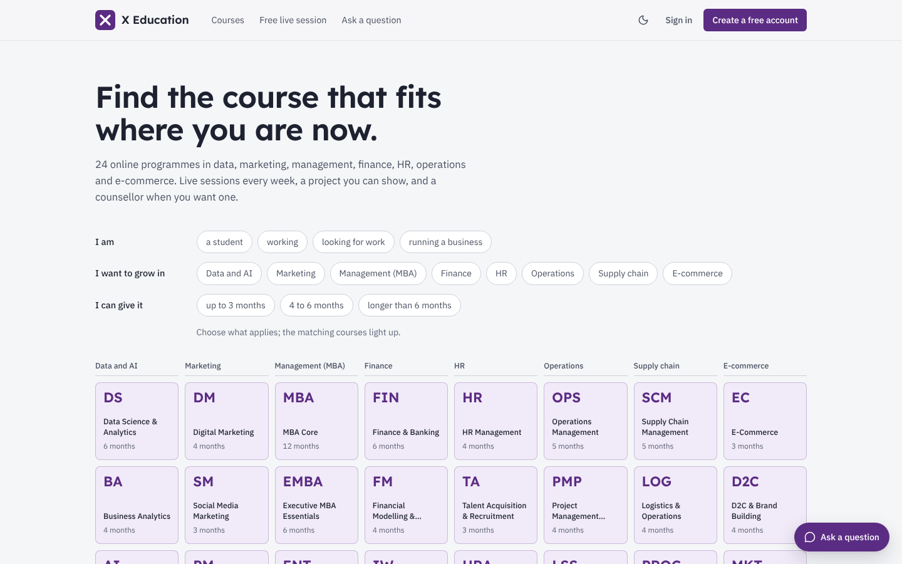
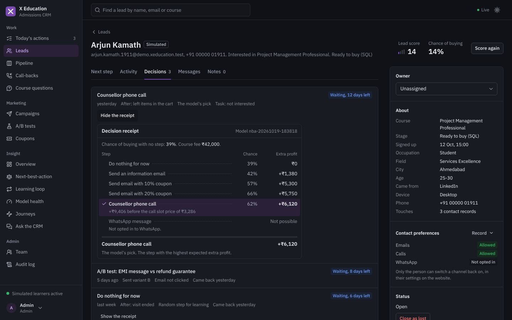
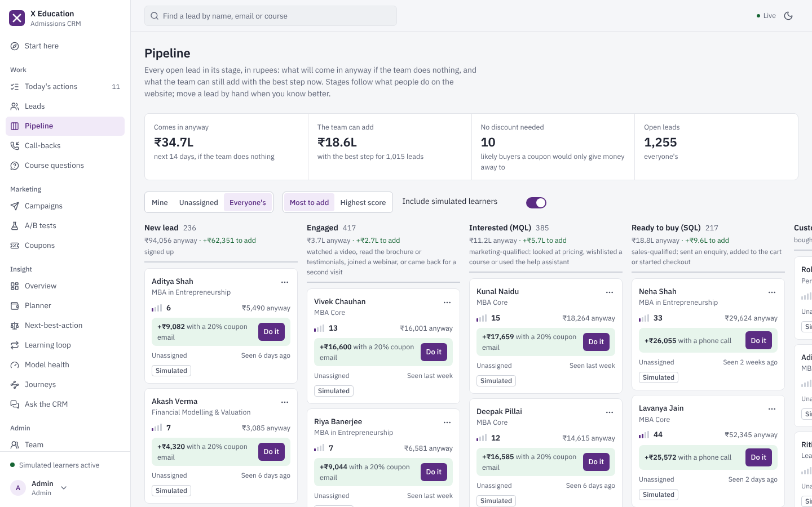
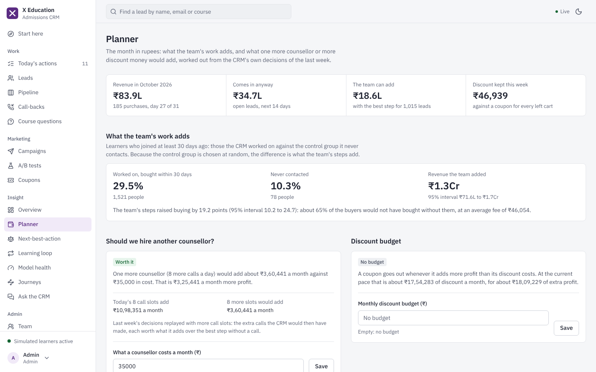
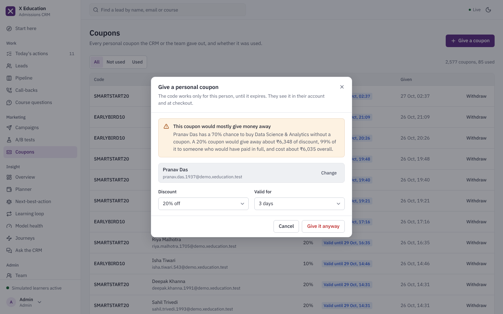
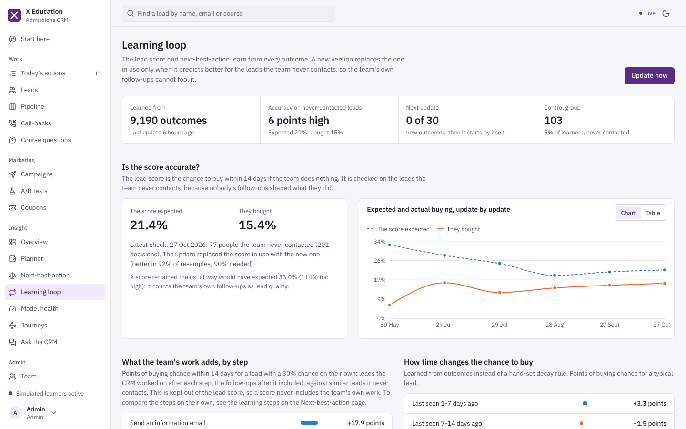
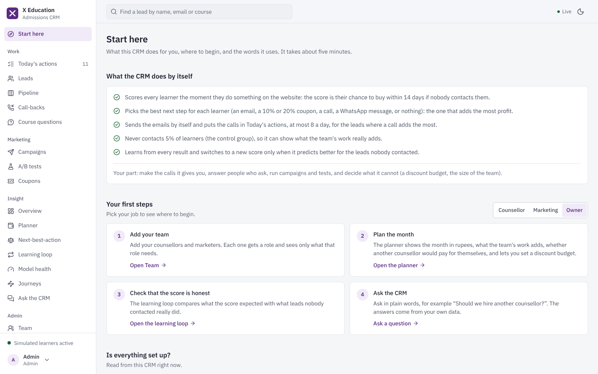
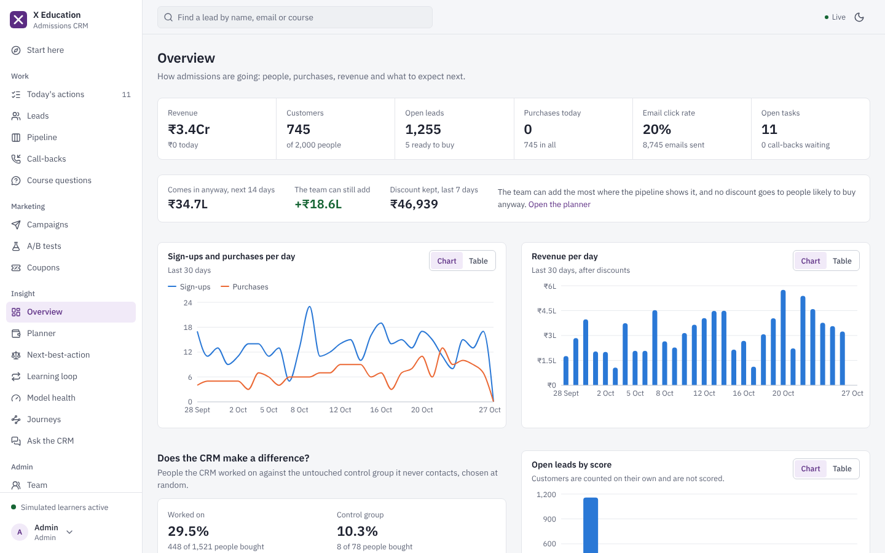

# X Education CRM

A lead-management and next-best-action CRM for an online-education business. Learners use a course website; the
admissions team uses a CRM; between them, an API scores every lead the moment they click, chooses the step most
likely to pay for itself (an email, a coupon, a call, WhatsApp, or nothing), prices the business's two scarce
resources (counsellor calls and discount money), shows the whole pipeline in rupees as what comes in anyway and what
the team can still add, and retrains its own models without mistaking its own follow-ups for lead quality. Built as a
final-year project, with the experiments behind a research paper in [`ml/`](ml).

| Part | What it is | Built with |
|---|---|---|
| Learner website | Course catalogue and finder, accounts with emailed codes, wishlist, cart, checkout, enquiries, call-back requests, a help assistant, reviews and questions, privacy settings including account deletion | React 19, TypeScript, React Router 7, TanStack Query 5, Tailwind CSS 4, Vite 7 |
| CRM dashboard | Today's actions, leads with decision receipts and what-if paths, the pipeline in rupees, call-backs, questions, campaigns, A/B tests, coupons with a coupon guard, the owner's planner, the learning loop, model health, journeys, an assistant over the CRM's data, team and audit log | the same, plus Recharts |
| API | Two APIs on one server (`/api/v1` for the website, `/api/v1/crm` for the team), the models, the background jobs and the simulated learners | Python 3.12, FastAPI, Pydantic 2, SQLite with Alembic migrations, scikit-learn, APScheduler |
| Research | Experiments E1 to E9 with fixed seeds, on two real public datasets and on simulation | the backend's own code, NumPy, pandas, SciPy, matplotlib |

Both apps have a light and a dark theme, work at phone width, and share one design system. Email (Gmail or any mail
server) and message drafting (Gemini) are optional: without them the system still runs end to end.

| | |
|---|---|
|  |  |
|  |  |
|  |  |
|  |  |
|  |  |

More screens in [docs/screenshots](docs/screenshots).

## What makes it different

1. **The pipeline in rupees.** For every open lead the CRM shows what comes in anyway if the team does nothing (the
   honest lead score times the fee) and what the team can still add with the best step now, and orders the work by
   it, with one click to take that step. On simulated pipelines with known truth both totals are within 2% of the
   truth, and working leads "most to add first" adds 89% to 93% of the most the team could add, against 4% to 62%
   for highest score first (E9).
   Lead-level screens (a lead's page, Today's actions, the cards) show only chances of buying, for example
   "6% → 9% with a 20% coupon email"; the rupee totals are the owner's forecast on the Pipeline, Overview and Planner.
2. **Counsellor time and discount money, priced.** Decisions arrive one at a time, so a daily call cap or a monthly
   discount budget would be handed out first come, first served. Instead each gets a price, re-solved at every
   decision from the CRM's own decision log (a bid price, as in airline revenue management), and a call or a coupon
   goes where it adds the most. Calls: 95% to 97% of the best allocation in hindsight, against 41% to 70% first come,
   first served (E7). Discount money: 97% to 100%, against 37% to 62%; a coupon for every left cart loses money (E9).
3. **A coupon guard.** Before anyone gives a coupon by hand, the CRM shows what it would do: the chance to buy without
   it, with it, and how much of the discount would go to someone who would have paid in full. A coupon that would
   mostly give money away needs a confirmation; one for the control group is never given. In simulation it stops
   coupons that truly lose money with 95% to 100% precision for warm leads and left carts (E9).
4. **The owner's planner.** What the team's work adds (measured against a control group the CRM never contacts),
   whether one more counsellor would pay for themselves (last week's decisions replayed with more call slots), and
   what more discount money would add. Estimates within 11% below to 15% above the truth in simulation (E9).
5. **Next-best-action on expected profit.** An uplift model estimates the chance to buy after each possible step and
   picks the step with the largest extra profit after costs, discounts and the two prices, or nothing. Every decision
   is explained by an itemised receipt (E2, E2b).
6. **A learning loop that does not fool itself.** The score is "the chance to buy if we do nothing"; what the CRM's
   own work adds is measured against the never-contacted control group and kept out of the score, and every new
   model is judged on that control group before it replaces the old one. On real randomised data, naive
   retraining over-predicts by 22%; this loop removes 88% of that bias, while the usual accuracy check would pick the
   naive model every time (E3, E8).
7. **A/B tests with a control group and automatic, checked adoption.** Winners become the standard email with a 10%
   holdback, and are switched back automatically if they stop winning (E4).
8. **What-if paths** for every lead (E5), **learned lead ageing** instead of hand-set decay (E6), and **leak-free lead
   scoring** that beats four published solutions on their own data (E1, E1b).

How each part works: [docs/HOW_IT_WORKS.md](docs/HOW_IT_WORKS.md). The numbers: [docs/RESEARCH.md](docs/RESEARCH.md).

## Quick start

Install **Python 3.10 or newer** (3.12 recommended; on Windows tick "Add python.exe to PATH") and **Node.js 20.19 or
newer** (the LTS version). Then, in the project folder:

| Windows | macOS, Linux |
|---|---|
| double-click `start-all.bat` | `./start-all.sh` |
| `stop-all.bat` stops everything | `./stop-all.sh` stops everything |

The first start installs the packages, trains the starting models and creates six months of history for 2,000
simulated learners: about 15 minutes. Later starts take seconds. When it is ready:

| | Address |
|---|---|
| Learner website | http://localhost:5173 |
| CRM dashboard | http://localhost:5174 |
| API documentation | http://127.0.0.1:8000/api/docs |

**First sign-in to the CRM:** the start window shows the owner's address and a random first password (also in
`backend/data/initial-admin-password.txt`); you choose your own password straight after, and the file is deleted.
Then open **Start here** at the top of the menu: a five-minute guide to what the CRM does by itself, where a
counsellor, a marketer and the owner each begin, whether email and the rest are set up, and the words it uses.
Without Gmail configured, sign-up codes for the website appear in the "X Education API" window (on macOS and Linux
in `backend/data/logs/api.out`).

A guided tour for a review or viva: [docs/DEMO_GUIDE.md](docs/DEMO_GUIDE.md) (start with "On the day of the demo";
its last section shows how to check the system yourself).

## Configuration

- **`backend/.env`** (optional, made from `backend/.env.example` at the first start): the CRM owner's address, Gmail
  (or any other mail server, with `SMTP_HOST`, `SMTP_PORT` and `SMTP_SECURITY`) for sending email, a Gemini key for
  message drafts, URLs and file locations. Never committed.
- **`crm_settings.json`**: the business rules the team may tune: tiers, the steps the CRM can take with their costs
  and discounts, the daily call capacity and how call slots are priced, how a discount budget is priced, the
  planner's counsellor numbers, automation timings, the learning loop, A/B test defaults, the control group, and the
  team's assignment and lock-out rules. The monthly discount budget and what a counsellor costs are set on the
  Planner page.

## Using it with real people

- **Real learners next to the simulated ones** (the default): real people sign up on the website and appear in the
  CRM straight away; every list can show real people only, simulated learners are tagged and never emailed, and Ask
  the CRM counts both separately ("How many leads came in this week?").
- **Email for real**: set `GMAIL_USER` and `GMAIL_APP_PASSWORD` (a Gmail app password) in `backend/.env`, or another
  mail server with `SMTP_HOST`, `SMTP_PORT` and `SMTP_SECURITY`. Start here shows whether email is set up. Emails the
  mail server does not take (a wrong password, no connection, Gmail's daily limit, about 500 emails for a personal
  account) are marked "not sent" with the reason and tried again automatically for a day; a campaign can also send
  them again at once.
- **Real learners only**: pause the simulated learners on the Simulation page (or set `SIMULATION_ENABLED=false`),
  stop the system, and run `python -m app.cli history remove` in `backend` (with its `.venv` active): every
  simulated learner and their history go, real learners and everything about them stay, and the starting models
  come back. Set `DEMO_MODE=false` for business timings: a left checkout is followed up after 30 minutes and a
  left cart after an hour, instead of about a minute (`automation_minutes` in `crm_settings.json`), and when the
  mail server fails, a sign-up is refused with the reason instead of writing the code to the log.
- **Payments** are a demonstration: checkout enrols the learner and says that nothing was charged.
- **Back up** by stopping the system and copying `backend/data` (the database, the models and the logs); copy it back
  to restore. A new version goes into a new folder; copy `backend/data` and `backend/.env` into it before its first
  start and its migrations bring the data up to date.

## Project layout

```
backend/            the API: app/ (api, services, ml, simulation, jobs, db, core) and tests/
frontend/           npm workspaces: web/ (website), crm/ (dashboard), shared/ (design system)
ml/                 experiments E1 to E9, their results and figures, the two real datasets
docs/               architecture, how it works, API reference, research, development, demo guide
scripts/            smoke test, latency and real-versus-simulated checks, emoji check, API reference generator
crm_settings.json   business rules
start-all.*         install, prepare and start everything; stop-all.* stops it
```

More detail: [docs/ARCHITECTURE.md](docs/ARCHITECTURE.md).

## Quality

- **Tests:** 124 backend tests (pytest, against a temporary database: accounts, the purchase journey, roles and
  record-level access, decisions and their receipts, call-slot and discount pricing, the pipeline in rupees, the
  coupon guard and the planner, the learning loop's step effects with known truth, migrations up and down, leakage,
  email and Gemini failures, a real SMTP conversation with a local mail server and its outages, two people acting
  at once, the simulated history) and 39 frontend tests (Vitest: component tests of the decision receipt, of signing
  out, of labelled fields and of pages a role may not open, and unit tests of the formatting, the labels, the money
  lines, the planner's verdicts and email-click counting).
  `scripts/smoke_test.py` checks a running system end to end over HTTP, and
  `scripts/real_vs_simulated_check.py` shows on a copy of your data that every page reads the same when all the
  simulated learners are turned into real people.
- **Static checks:** Ruff (lint and format) for all Python, strict TypeScript, ESLint and Prettier for the frontend,
  a check that no emoji appears anywhere, and an API reference generated from the code.
- **CI:** GitHub Actions runs all of it, and the production builds, on every push and pull request (the backend on
  Python 3.10 and 3.12).
- **Security:** salted PBKDF2 passwords, one-time codes stored as keyed hashes, lock-out after wrong passwords, JWTs
  with separate audiences that end when a password changes, roles checked on every request, an audit log without
  personal data, and account deletion that removes every linked record. See [docs/ARCHITECTURE.md](docs/ARCHITECTURE.md#security-and-privacy).

How to work on the code: [docs/DEVELOPMENT.md](docs/DEVELOPMENT.md).

## Research results at a glance

| | Question | Result |
|---|---|---|
| E1 | How good is the lead-scoring method on real leads, without leaked columns? | AUC up to 0.875 on 9,240 real X Education leads using only the 9 columns a new lead has (logistic regression 0.838); 0.98 is only reachable with columns sales fills in after contact |
| E1b | Does it beat published solutions on their own data? | Higher AUC than all four public solutions re-run exactly (+0.004 to +0.030; better in 30 of 30 new splits); 0.874 on new-lead inputs, above the best published 0.8605 in 98% of splits |
| E2 | Does next-best-action pick the right people and emails on a real experiment? | On Hillstrom (64,000 customers, randomised emails), with a 10% email budget: 13.7 extra visits per 1,000 customers, level with the best of eleven policies (13.9, within noise), against 11.1 for response-score targeting and 5.5 at random |
| E2b | Does it still win when the assumptions about the world are wrong? | Beats the best fixed policy in 20 of 20 random simulated worlds (median 83% of the oracle's profit, 87% with the champion/challenger rule, against 27% for the best fixed policy) |
| E3 | Does the learning loop fool itself? | Naive retraining over-predicts by 2.35 points (22%); ours removes 88% of that bias; the usual check picks the naive model in 50 of 50 repeats |
| E4 | Can the A/B verdicts be trusted? | False alarms 3.7% (should be at most 5%), interval coverage 95.2%, power 79.8% at the planned size |
| E5 | Do the what-if paths predict what learners do next? | A little: out of time in six histories, Brier 0.541 against 0.545 for a stage-only mix (better in 4 of 6) and 0.561 for one mix for everyone |
| E6 | Is learned lead ageing better than hand-set decay rules? | Lowest log-loss of all (0.3587 against 0.3747 to 0.3812 for no ageing, HubSpot-style and Salesforce-style decay and a naive retrain), every difference with its 95% interval above zero |
| E7 | Does pricing call slots beat first come, first served? | 95% to 97% of the hindsight value against 41% to 70% when demand is 2 to 8 times capacity; no cost with spare capacity |
| E8 | Inside the product, is the score honest about leads nobody contacted? | With each step's effect from the control group it over-states their buying by 6%, against 31% for a naive retrain; better on average than letting the model learn the effects (13%), but not significantly with three histories |
| E8b | What do the random learning steps cost? | In 14 simulated worlds over 12 months, no random steps earned more than 15% in 12 (₹567 per lead); 5% was not clearly better than 15%. The product keeps 15%, without which nothing can be measured |
| E9 | Do the money features pay, and are their numbers right? | A priced discount budget gets 97% to 100% of the hindsight value (first come 37% to 62%); "most to add first" 89% to 93% of the most possible (highest score first 4% to 62%); pipeline totals within 2% of the truth; the coupon guard 95% to 100% precise for warm leads and left carts; planner estimates within 11% below to 15% above |

The full table with every baseline, the methods and where it does not win: [docs/RESEARCH.md](docs/RESEARCH.md). Every
number comes from `python ml/run_experiments.py` and the scripts it names. The real-data studies and the simulations
on a fixed calendar repeat exactly; a simulated history ends at the moment it is made, so the studies built on
histories (E5, E6, E8 and the six-history report) give slightly different simulated numbers on each run. Simulated
results describe the documented simulator, not a market.

## Data

Two public datasets are kept in [`ml/data`](ml/data) for reproducibility: the X Education lead-scoring dataset
(Kaggle) and Kevin Hillstrom's MineThatData email experiment (2008). The learners in the CRM are simulated and
marked as such (addresses on the reserved `demo.xeducation.test` domain, never emailed); everyone who signs up on the
website is a real lead and is treated exactly like them.
