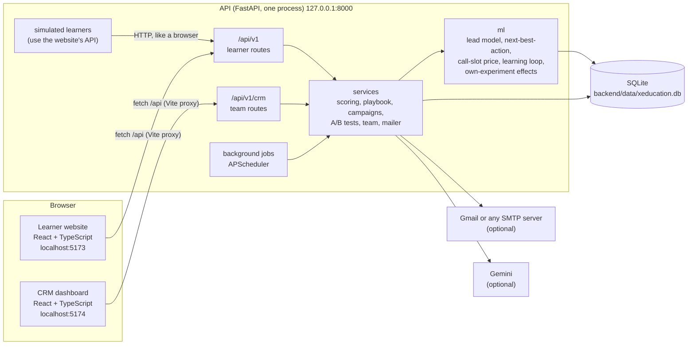

# Architecture

X Education CRM has three parts that run on one computer: the **learner website**, the **CRM dashboard** for the
admissions team, and the **API** that serves both, scores every lead, decides the next step and learns from the
results. A fourth part, **ml/**, holds the research experiments behind the paper; it uses the backend's own code.



## Repository layout

```
backend/            the API (Python 3.10+, FastAPI)
  app/
    api/            HTTP layer only: routers, request dependencies (who is calling, may they do this)
      learner/      /api/v1: accounts, courses, activity tracking, commerce, support
      crm/          /api/v1/crm: sign-in, dashboard, leads, actions, outreach, campaigns, insights, team
    schemas/        Pydantic request models (validation and the OpenAPI description)
    services/       business logic: scoring, playbook (carries out a decision), campaigns, A/B tests, adoption,
                    leads, lifecycle, team, analytics, money (the pipeline in rupees, the coupon guard), planner,
                    assistants, content, mailer, Gemini client
    ml/             models and decisions: features, lead model, predict, next-best-action, capacity (call-slot
                    price), budget (price of discount money), learning loop, anchor (each step's effect from the
                    CRM's own control group), journeys, what-if paths, A/B statistics; training/ trains the starters
    simulation/     the simulated learners: population, true effects, starting history, live simulation
    jobs/           the background scheduler and the follow-up automations
    db/             database access helpers and the Alembic migrations
    core/           settings (.env), business rules (crm_settings.json), security, logging, errors, timing
    resources/      the course catalogue and the FAQ (the only source of course facts)
  tests/            pytest suite (runs against a temporary database)
frontend/           npm workspaces
  shared/           design tokens, UI primitives (buttons, forms, tables, dialogs, toasts), formatting, HTTP client
  web/              the learner website
  crm/              the CRM dashboard
ml/                 research: experiments E1 to E9, results, the two real datasets
scripts/            project checks: smoke test, emoji check, API reference generator
docs/               this documentation
crm_settings.json   business rules the team can tune (read by the backend and the experiments)
```

## The backend in layers

Requests go down the layers and never up: `api` calls `services`, which call `ml` and `db`. The API layer only
translates HTTP (validation, status codes, who may do what); everything a person could also trigger from a job, a
campaign or the simulator lives in `services`, so the same rule runs the same way from every entry point.

| Layer | Knows about | Does not know about |
|---|---|---|
| `api` | HTTP, tokens, roles, request schemas | SQL details, model internals |
| `services` | business rules, the database helpers, the models | HTTP |
| `ml` | features, models, statistics, the decision log | HTTP, email |
| `db` | SQLite, migrations | everything above |

One process, one worker: the background jobs run inside the API process (`app/jobs/scheduler.py`), so the start
scripts run a single Uvicorn worker. SQLite runs in WAL mode with a 30-second busy timeout, so the website, the CRM,
the jobs and the simulated learners can read while one of them writes.

## From a click to a decision to a result

1. **Event.** The website reports what a learner does (`POST /api/v1/track`: page views, pricing page, video,
   brochure, chat, webinar, wishlist, cart, checkout, enquiry) and keeps the visit alive with a ping every 30 seconds.
2. **Score.** Every event re-scores the learner at once (`services/scoring.py` with `ml/predict.py`): the chance to
   buy within 14 days if the team does nothing now, as a 0 to 100 score with a tier and the factors behind it.
3. **Trigger.** The automations (`jobs/automations.py`) notice moments worth acting on: a checkout or cart left, a
   wishlist, a visit that ended, an enquiry, a callback request.
4. **Decide.** Next-best-action (`ml/nba.py`) estimates the chance to buy after every step the team could take
   (nothing, an information email, a 10% or 20% coupon email, a call, WhatsApp), turns each into expected extra
   profit, removes steps the person has not allowed, charges a call the current price of a call slot
   (`ml/capacity.py`) and a coupon the current price of discount money when there is a monthly budget
   (`ml/budget.py`), and picks the best, with a small share of random choices for learning. The decision is logged
   with its propensity, its prices and its receipt.
5. **Act.** The playbook (`services/playbook.py`) sends the email (with a tracked link and one-click unsubscribe) or
   puts a call or WhatsApp task in the team's list, assigned to a counsellor.
6. **Outcome.** A purchase within the outcome window closes the loop. The learning loop (`ml/learning.py`) retrains
   when enough new outcomes are known, judges the challenger on the control group the CRM never contacts, and swaps
   models only when the evidence is strong.
7. **Money.** The pipeline (`services/money.py`) values every open lead the same way, in one batch: what comes in
   anyway and what the best step would add; the coupon guard and the owner's planner (`services/planner.py`) read
   the same numbers and the decision log.

## Background jobs

| Job | Every | What it does |
|---|---|---|
| automations | 1 min (demo) / 5 min | follow-ups for checkouts, carts, wishlists and visits that ended |
| campaigns | 1 min | sends campaigns whose time has come |
| team | 1 min | expires stale tasks, gives new leads to counsellors |
| adoption | 5 min | adopts final A/B winners, re-checks adopted emails against their holdback |
| score refresh | 5 min (demo) / 60 min | re-scores every lead (time away changes the score) |
| learning loop | 5 min (demo) / 60 min | retrains when enough new outcomes are known |
| housekeeping | 60 min | deletes expired one-time codes and test inbox emails |
| simulated learners | 10 s | the live simulation (does nothing while switched off) |

## Data

One SQLite file, `backend/data/xeducation.db`, created and upgraded only by versioned Alembic migrations
(`backend/app/db/migrations/versions`, applied by `python -m app.cli migrate` and at every start). The main tables:

| Area | Tables |
|---|---|
| Learners | `users`, `user_profiles`, `otp_tokens`, `user_sessions`, `behaviour_events`, `chat_messages` |
| Commerce | `cart`, `wishlist`, `checkout_sessions`, `purchases`, `reviews`, `qna`, `coupons_issued` |
| Scores | `leads` (one row per scoring event), `live_user_state`, `lead_score_history`, `score_snapshots` |
| Decisions | `nba_decisions` (receipt, propensity, slot price, coupon value, expected discount and its price), `sales_tasks`, `email_sends`, `sms_queue`, `call_slot_prices` |
| Learning | `learning_runs`, `experiment_assignments`, `ab_tests`, `campaign_schedules`, `adopted_emails` |
| Team | `team_members`, `lead_owners`, `lead_notes`, `pipeline_overrides`, `callback_requests`, `login_attempts`, `audit_log` |
| Other | `app_settings`, `copilot_log`, `simulated_inbox` |

The trained models live next to the database in `backend/data/models` (joblib files with a JSON model card each).
Nothing in `backend/data` is tracked by git; the first start makes all of it.

## Configuration

Two files, for two kinds of setting:

- **`backend/.env`** holds what differs between computers: the CRM owner's address, optional Gmail (or another
  mail server) and Gemini keys, URLs, file locations. Every value is optional; `backend/.env.example` lists them all.
  It is never committed.
- **`crm_settings.json`** holds the business rules the team may tune: tiers, the steps the CRM can take with their
  costs and discounts, the daily call capacity and how call slots and discount money are priced, the planner's
  counsellor numbers, timings, the learning loop, A/B defaults, the control group, the team's lock-out and assignment
  rules. The backend and the experiments read the same file, so a rule is changed in exactly one place. The owner's
  monthly discount budget and what a counsellor costs are kept in `app_settings` and set on the Planner page.

## Security and privacy

| Concern | How it is handled |
|---|---|
| Passwords | Salted PBKDF2-SHA256, 600,000 iterations (OWASP 2023). A wrong address takes as long as a wrong password, so nobody can find out which addresses exist. At least 8 characters (NIST SP 800-63B); team passwords also need a digit. |
| One-time codes | Six random digits, valid 10 minutes, stored only as HMAC-SHA256 keyed with the server secret, burned after 5 wrong guesses, one resend a minute. |
| Lock-out | 5 wrong passwords lock an address for 15 minutes, separately for learners and the team. |
| Tokens | JWT (HS256) with separate audiences for learners and the team, an expiry (7 days, 12 hours), and a fingerprint of the password hash: changing or resetting a password signs out every other session. |
| Roles | Checked by the API on every request (admin, marketing, counsellor), plus record-level access: a counsellor changes only their own and unassigned leads. The dashboard only hides what a role cannot use. |
| First sign-in | The owner's first password is random, written once to `backend/data/initial-admin-password.txt` (never to the log) and must be changed at the first sign-in, like every account an admin creates. |
| Audit | The audit log names the people on the team and refers to leads by number only: no notes, emails or phone numbers. |
| Erasure | A learner deletes their account and every record linked to it from Settings (`DELETE /api/v1/me`). |
| Consent | Email, call and WhatsApp consent are checked before every automatic step; every marketing email has one-click unsubscribe (RFC 8058 headers). |
| Headers | `X-Content-Type-Options`, `X-Frame-Options: DENY`, `Referrer-Policy`, `Cache-Control: no-store`, a request id, and CORS limited to the two frontends. |
| Secrets | `backend/.env` and `backend/data/` are ignored by git; `.env.example` holds empty values only (a test checks this). |
| Errors | Unexpected errors are logged with the request id and answered with a generic message, never a stack trace. |

## Only the learners are simulated

To show the CRM working without real traffic, simulated learners use the website the way people do: over HTTP, with
the same requests a browser sends, signed in with the website's own tokens. Everything they cause goes through the
same code as a real person: scoring, decisions, emails, tasks, the learning loop. They are told apart in one way
only: their addresses are on the reserved domain `demo.xeducation.test`, so they are never emailed and the dashboard
can filter them. Nobody on the team is simulated: a simulated learner's call task waits for a real counsellor, and
when someone presses Call, the simulator decides whether the learner answers.

The starting history (2,000 learners over six months) is made by the same code at the first start, so the dashboard
and the learning loop have data from minute one. `python -m app.cli history remove` deletes every simulated learner
and their records and restores the starting models; real people are not touched.
