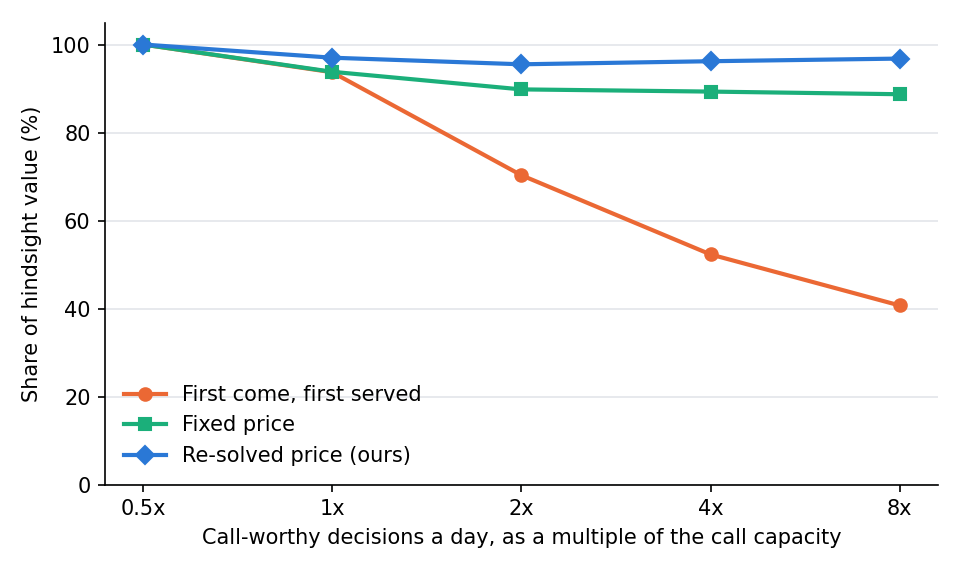
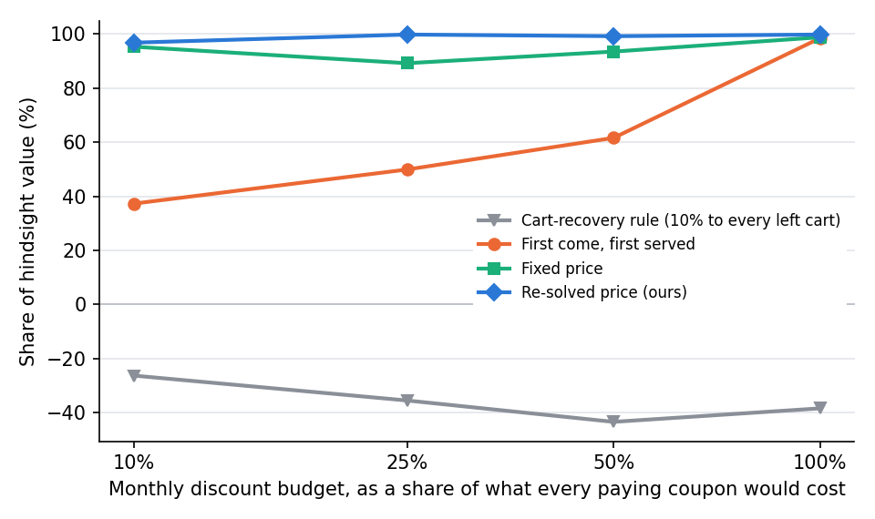

# Research results

What this CRM does better than common practice, how each claim was measured, and where it does not win. Every number
is produced by a script in this repository with fixed seeds (results in [`ml/results`](../ml/results), figures in
[`ml/results/figures`](../ml/results/figures)). The real-data studies and the simulations on a fixed calendar repeat
exactly; the studies built on simulated histories vary slightly from run to run (see section 5). Simulated learners
are always called simulated; claims about real behaviour rest only on the two real datasets.

**In five lines.**
(1) On the standard ed-tech lead dataset, with the same rows and inputs as every public solution we could re-run, our
score ranks leads better; with only what a new lead has, it reaches AUC 0.874, the best leak-free result we found.
(2) On a real randomised experiment, our retraining removes 88% of the bias a normal CRM gives itself and is the best
deployable method on one proper scoring rule in 49 of 50 repeats.
(3) Pricing the team's scarce call slots captures 95% to 97% of the best possible allocation in hindsight, against
41% to 70% for the usual first come, first served, when calls are in demand.
(4) Learned lead ageing beats hand-set decay rules on log-loss, with 95% intervals above zero.
(5) Counting the pipeline, the discount budget and the team's time in rupees of *extra* profit pays: in simulations
with known truth, a priced monthly discount budget gets 97% to 100% of the best allocation in hindsight (first come,
first served 37% to 62%; a coupon for every left cart loses money), working leads "most to add first" adds 89% to 93%
of the most the team could add (highest score first: 4% to 62%), and the coupon guard stops coupons that truly lose
money with 95% to 100% precision for warm leads and left carts.

## 1. The problem

An ed-tech CRM scores leads, decides who gets an email, a coupon or a counsellor's call, and retrains its score on who
enrolled. Four things make it look better than it is, and the usual checks are fooled in the same way:

| Failure | What happens | Common practice |
|---|---|---|
| **Leakage** | Scores built on fields sales fills in *after* contacting the lead (Tags, Lead Quality, Last Activity) look excellent offline and cannot score a new lead. | Most public solutions on the standard X Education dataset use them. |
| **Feedback** | Hot leads get the follow-ups, the follow-ups make them enrol, and a retrained score learns the CRM's own follow-ups as lead quality. The usual accuracy check, on data the CRM's actions shaped, prefers the inflated model. | Salesforce Einstein "analyzes your past converted leads"; HubSpot learns from opens, clicks and meetings. Neither help page describes separating the company's own outreach from lead quality. |
| **Staleness** | Leads who browse for weeks without enrolling are weaker buyers than their signals say, even right after a visit. | Hand-set decay on inactivity (HubSpot: "lose 25% or 50% after one month"; Salesforce Account Engagement: "decay scores above 50 to 50 if the last activity is more than 45 days ago"). It never touches an active old lead, and nobody checks its size. |
| **Scarce calls** | Counsellors can make only so many calls a day, but decisions arrive one at a time; a daily cap gives slots away first come, first served. | Uplift targeting with a budget is usually solved once over a whole customer list (for example Sapru 2025; Guduguntla et al. 2026), not for decisions that arrive through the day. |
| **Discounts to buyers anyway** | Coupons go to whoever left a cart or looks hot, and most of the money goes to people who would have paid in full; a monthly discount budget is spent first come, first served. | Cart-recovery flows attach a discount code to every abandoned-checkout email (for example Klaviyo's and Shopify's guides); a discount given by hand is not checked against the chance to buy without it. |
| **A forecast that includes the team** | The pipeline is valued with probabilities learned from leads the team worked, so it cannot say what comes in anyway and what the team's work adds; lists sorted by score put first the leads who would buy anyway. | HubSpot gives each deal stage a fixed win probability; Salesforce Pipeline Inspection groups deals by forecast category (Commit, Best Case), "controlled by the deal stage". |

## 2. What the CRM does instead

1. **Scores only on what a lead has when it arrives**, re-scored on every website event in real time (event to new
   score: 47 to 74 ms median over HTTP, 41 to 63 ms inside the server; Einstein's help page says scores are
   "updated at least every six hours").
2. **Retraining is told what the CRM did** (email, coupon, call, WhatsApp, campaign) and reads the score with it
   switched off: the chance to buy if we do nothing now. The effect of each next-best-action step is not left to the
   model: it is measured from the CRM's own experiment (leads acted on against leads of the never-contacted control
   group that it would have treated the same way) and fixed while the score is refitted.
3. **Time effects are learned, not set by hand**: time since the last visit and the lead's age.
4. **Every model change is validated on an untouched control group** (5% of leads, never contacted) and made only if
   better in at least 90% of bootstrap resamples.
5. **Next-best-action by uplift** (which step changes the outcome, after costs and discounts), with 15% random
   choices logged with their probability, so every policy can be evaluated without bias.
6. **Call slots and discount money have a price**, re-solved at each decision from the CRM's own decision log (a bid
   price, as in revenue management), so a call or a coupon goes to the lead it helps most, not the lead who came
   first, and a monthly discount budget lasts the month.
7. **Everything is counted in rupees of extra profit**: the pipeline shows what comes in anyway and what the team can
   add, lead by lead, and orders the work by it; a coupon given by hand is checked first (the coupon guard); and the
   owner's planner values the team's work, one more counsellor and more discount money from the same numbers.

How each works: [HOW_IT_WORKS.md](HOW_IT_WORKS.md).

## 3. The metrics: honest means measured on outcomes nobody's actions shaped

- **ROC AUC on identical test rows**, with DeLong's 95% interval and paired test, for lead scoring on real data.
- **Feedback bias**: the mean predicted minus actual rate on people a randomised experiment left alone.
- **Honest log-loss**: log-loss on those people. It is a proper scoring rule, so it rewards ranking *and* honest
  probabilities at once: one number for "best overall".
- **Calibration by lead age**: the weighted mean of |expected minus actual| over the age groups of the leads.
- **Share of hindsight value** (call slots, discount budget): the part of the value of the scarce resource a rule
  captures, between not using it (0%) and the best allocation with hindsight (100%), scored with the simulator's true
  effects.
- **Money estimates against the truth** (pipeline, planner): the predicted total over the true total, with the
  simulator's true probabilities; and the share of the most the team could add that an order of work captures.

## 4. The results

| # | Claim | Ours | Best baseline | How measured | Data |
|---|---|---|---|---|---|
| R1 | Lead scoring, **same rows and same inputs** as each of four public solutions | AUC higher for all four: **+0.004 to +0.030**; better in **30 of 30** new splits for each, every 95% interval above zero | their own models (AUC 0.864 to 0.972) | DeLong on their own test rows; 30 new 70/30 splits, corrected t-interval | X Education, 9,240 real leads ([published_benchmark.md](../ml/results/published_benchmark.md)) |
| R2 | Lead scoring **for new leads** (no post-contact column) | **AUC 0.874** with 9 columns | 0.8605 (MSc thesis, NCI 2025); 0.864 (the best leak-free public solution) | 50 stratified 80/20 splits (above 0.8605 in 98%); +0.011 on that solution's own rows (DeLong p 0.0009) | same |
| R3 | The published accuracies above 90% need leakage | refitted without post-contact columns those solutions fall to AUC 0.599, 0.785 and 0.862; no leak-free model here exceeds AUC 0.886 or 81.4% accuracy | none | same rows, their own models | same |
| R4 | Retraining that does not fool itself | **feedback bias +0.33 points**, so **88% removed** (95% interval 72% to 104%); not distinguishable from a model with no loop at all | naive retrain +2.35 points (22% of the true rate) | 50 repeats, corrected resampled t-interval | Hillstrom real randomised email experiment, 42,613 customers ([learning_loop.md](../ml/results/learning_loop.md)) |
| R5 | **Best deployable retraining method** on one proper scoring rule | lowest honest log-loss in **49 of 50** repeats | naive retrain; retraining on the control group only (the clinical-ML holdout approach); inverse-propensity weighting | same | same |
| R6 | Choosing the model honestly | wrong switch in **2 of 50** | the usual check (fit on the CRM's own data) picks the inflated model in **50 of 50** | same | same |
| R7 | **Learned lead ageing** against hand-set decay | **lowest log-loss of all** (0.3587) and lowest calibration error by lead age (3.4 points); leads 7 days and older over-predicted by +23% instead of +40% | log-loss: no lead age 0.3758; HubSpot-style decay −25% and −50% after a month 0.3747 and 0.3810; Salesforce-style inactivity cap 0.3758 (changes nothing: the leads are active); naive retrain 0.3812. Every log-loss difference has its 95% interval above zero. Calibration 4.5 to 8.4 points (interval above zero against no lead age, the inactivity cap and naive; not against the two HubSpot-style rules) | 1,078 decision points where the CRM did nothing (control group and random picks), out of fold, cluster bootstrap over people | three simulated 180-day histories made by the CRM ([lead_age_check.md](../ml/results/lead_age_check.md)) |
| R8 | Who gets an email: uplift against likelihood | **+2.6 extra visits per 1,000** at a 10% email budget (95% interval +0.5 to +4.7) | targeting by predicted response (what score-based CRMs do) | inverse-propensity estimates on held-out customers, paired bootstrap | Hillstrom, 64,000 customers ([hillstrom_uplift.md](../ml/results/hillstrom_uplift.md)) |
| R9 | Next-best-action profit | **3.5 times** the profit of lead-score targeting, **90.5%** of the oracle; beats the best fixed policy in **20 of 20** random worlds (median 83% of the oracle; champion/challenger 87%) | lead-score targeting, the tier playbook, emailing everyone | known true effects | simulator ([nba_policy_comparison.md](../ml/results/nba_policy_comparison.md), [nba_robustness.md](../ml/results/nba_robustness.md)) |
| R10 | A/B statistics that can be trusted | 3.7% false alarms on A/A tests, 95.2% interval coverage, 79.8% power at the planned size; in 36 tests inside six histories: 15 correct, 15 real effects missed where the audience was too small, 6 still running, **0 wrong** | the targets: at most 5%, 95%, 80% | 4,000 simulated tests per check; six histories | ([ab_engine_check.md](../ml/results/ab_engine_check.md), [history_runs.md](../ml/results/history_runs.md)) |
| R11 | The CRM's total impact | worked-on leads bought within 30 days **+12.5 points** more often than the untouched control group (31.0% against 18.6%; 95% interval +8.6 to +15.8); positive in 6 of 6 histories | none | six simulated histories pooled | ([history_runs.md](../ml/results/history_runs.md)) |
| R12 | The live system continues its history exactly | every learner's daily chance to buy: largest difference **1.1e-16** over 145 learners, on a 60-day history with campaigns, an A/B test with coupons and visits after email clicks | none | `python -m app.cli simulation self-check` | simulated |
| R13 | The loop inside the product | predicts the untouched control group better than a naive retrain in **31 of 36** learning runs; over-states its buying by +23% in the final runs against +59% for the naive retrain; the usual check would pick the naive model in **35 of 36**; swaps models only 7 times in 36 runs. Against the model learning the steps' effects itself: better in 10 runs, worse in 7, the same in 19 (too few control-group decisions yet), mean log-loss 0.4108 against 0.4144 | naive retrain; the model learning the effects itself | 36 learning runs, judged on the control group | six simulated histories ([history_runs.md](../ml/results/history_runs.md)) |
| R14 | **Capacity-aware next-best-action** | with call-worthy decisions at 2 to 8 times the capacity, the re-solved slot price captures **95% to 97%** of the hindsight value (+₹23,258 to +₹88,039 a day at 20 calls a day); with demand doubling half-way through, 94.8% and 96.5%; with spare capacity the same as first come, first served | first come, first served 41% to 70%; a fixed daily price about 89% | 10 simulated runs of 60 days per scenario, the production pricing code, scored with the true effects, 95% intervals across runs | simulator ([capacity_check.md](../ml/results/capacity_check.md), figure `capacity_share.png`) |
| R15 | What-if paths predict what learners do next | Brier score **0.541** on average for the next three days' reaction; better than the stage-only mix in **4 of 6** histories | 0.545 per stage ignoring the step; 0.561 one mix for everyone | out of time in each history: learned before two thirds of it, tested on the later decisions (about 2,000 each), weighted by 1/probability | six simulated histories ([paths_check.md](../ml/results/paths_check.md)) |
| R16 | Real time | a website event to the learner's new score: median **47 to 74 ms**, 95th percentile 59 to 101 ms over HTTP; 41 to 63 ms inside the server (two fresh installs on the same computer, 25 and 27 Oct, with the simulated learners running) | Einstein: "at least every six hours" | 300 events of one test learner, `scripts/latency_check.py` | the running system |
| R17 | Each step's effect from the never-contacted control group, inside the product | at the product's settings (5% control group, 15% random steps), judged on learners nobody contacted or trained on: over-states buying by **+6%** at the last learning date (naive retrain +31%, the model learning the effects itself +13%); log-loss −3.4 x 10^-3 against the latter (95% interval −9.6 to +3.3), −5.1 over all 15 learning dates (−10.8 to +1.2), lower at 11 of 15 dates, never the worst method. Not significant with three histories | naive retrain +23.2 (+12.3 to +34.4); the paper's cut-off estimator +1.7 (−1.0 to +4.8) | 11 histories of 180 days in five settings, 10% evaluation group never contacted, paired cluster bootstrap | simulated histories ([anchored_check.md](../ml/results/anchored_check.md)) |
| R18 | What the random learning steps cost | 5% against 15%: more profit in 9 of 14 worlds, not significant (sign test p 0.42; mean −₹94 per lead, 95% interval −₹367 to +₹107). **0% against 15%: more profit in 12 of 14 worlds** (p 0.013; +₹567 per lead, +₹270 to +₹890), but no experiment left to measure anything | the product keeps 15% | closed loop, 12 months, 1,000 leads a month, 14 worlds of E2b, 5 runs each | simulator ([exploration_check.md](../ml/results/exploration_check.md)) |
| R19 | **A priced monthly discount budget** | with a budget of 10% to 50% of what every paying coupon would cost, **96.8% to 99.8%** of the value of the best single price chosen with hindsight (+₹15.7 lakh to +₹30.6 lakh a month over first come, first served); 95% to 97% of the budget used, in truth; with money for every paying coupon, the same as the others | first come, first served 37.3% to 61.6%; a fixed price for the month 89.2% to 95.3%; a 10% coupon for every left cart −26% to −43% (it loses money) | 10 runs of two months, 300 decisions a day, the production pricing code, true effects; 95% intervals across months | simulator ([money_check.md](../ml/results/money_check.md), figure `money_budget_share.png`) |
| R20 | **The coupon guard** | coupons a counsellor would give to the warmest 10% of leads: all stopped, **98% to 100%** of them truly lose money; to every left cart: 59% to 67% stopped, **95% to 96%** rightly, turning a loss of ₹48,000 to ₹2.6 lakh per 100 coupons into a profit of ₹1.6 to ₹1.8 lakh; to leads at random: 36% to 45% stopped, 74% to 80% rightly | giving every coupon | 60,000 simulated leads, true effects | simulator (same) |
| R21 | **The pipeline in rupees** | "comes in anyway" **1.001** of the true total, "the team can add" **1.017**; working 5% to 40% of 1,200 open leads most-to-add first adds **89% to 93%** of the most possible; 91% of leads marked "No discount needed" truly lose money with a coupon | highest score first 4% to 62%; at random 24% to 50%; "likely to buy anyway" alone as the badge 73% | 200 pipeline snapshots, true effects | simulator (same) |
| R22 | **The owner's planner** | one more counsellor (8 more calls a day): estimate **0.89 to 1.03** of the true extra profit at call demand 1 to 8 times the slots; today's slots 1.01 to 1.04; 20% more discount money 0.88 to 1.15 when the budget is tight | ranking each day's calls instead of replaying the CRM's rule: 0.31 to 1.05 (0.31 at demand 1x) | the same simulated days run with and without the extra slots or money | simulator (same) |
| R23 | **The money view inside the product** | at each learner's first decision in six histories: "comes in anyway" for the control group **₹7,903** per learner expected against **₹6,459** actual (95% interval ₹4,889 to ₹8,099); what the CRM expected its first step to add **₹2,310** against the measured difference between worked-on and control learners **₹3,180** (₹1,511 to ₹4,800), which also includes the CRM's later steps. Both inside the intervals; the control group is small (477 learners) | none | 10,056 first decisions with a full 14-day window; the control group is chosen at random | six simulated histories ([history_runs.md](../ml/results/history_runs.md), section 5) |





## 5. Where it does not win

- **Uplift learners on real data.** At a 10% budget our interpretable uplift model is significantly better than score
  targeting and the gradient-boosting learners, but level with the linear T-learner and class transformation (−0.2
  and +0.1 visits per 1,000, not significant); at larger budgets no policy is significantly better than targeting by
  response.
- **Ranking alone.** Naive retraining ranks as well as ours (honest AUC 0.637 against 0.638); the damage is to the
  probabilities, which is exactly what decides who is worth a call or a coupon.
- **When nothing works.** In a simulated world where no step changes anything, our model still contacts about half of
  the leads on estimation noise and loses ₹18,671 per 1,000 leads; the right answer (contact nobody) loses nothing. A
  confidence bound on the uplift would avoid this.
- **Hidden effects.** When most of a step's effect runs through things the interpretable model cannot see, the
  flexible model does better (it won 6 of 10 such worlds); the champion/challenger rule picked the better family in
  13 of 20 worlds.
- **Control groups are small** (5%). Our control-group check makes the right switch only when the difference is clear
  (11 of 50 on the real experiment) and the wrong one rarely (2 of 50). Inside the product, the loop still
  over-states the control group's buying (+23% in the final runs); most of the gap sits in leads older than a week
  ([followups_check.md](../ml/results/followups_check.md)), and later follow-ups inside the outcome window explain part
  of it (from +24.5% to +16.9% with one touch per 14 days).
- **A/B tests on small audiences** miss real effects (15 of 30 in the histories); the plan shown before sending warns
  when an audience is smaller than the planned size.
- **What-if paths are only a little better than a simpler guess**: better than the stage-only mix in 4 of 6
  histories (mean Brier 0.541 against 0.545).
- **The random learning steps cost money in simulation** (R18). With none, the CRM earned more in 12 of 14 simulated
  worlds (₹567 per lead on average), and 5% was not clearly better than 15%. The product keeps 15%: without random
  steps nothing can be measured (which step works, an honest check of a new policy), and the CRM could not notice
  when the world changes. The owner can change `exploration_rate`; this is a business choice, not a proven gain.
- **The step effects from the control group are not proven better** (R17). At the product's settings they are better
  on average and never the worst, but the 95% intervals include zero with three histories. Without random steps they
  are worse on average (+3.3, −3.3 to +10.1), and the research paper's cut-off estimator is clearly worse there (+25.2,
  +9.0 to +44.0): a lead the CRM leaves alone now is usually followed up at its next trigger, so the cut-off measures
  acting now against acting later, not against never.
- **The capacity and money results are simulated.** The true effects of a call or a coupon come from the simulator,
  and the next-best-action model was trained on a randomised campaign from the same simulator: the best case for the
  model (with perfect predictions, the discount budget would earn 22% to 32% more than with the model's, R19). The
  cart-recovery result rests on the simulator's assumption that coupons barely move people already at checkout. The
  prices need a week of decisions before they are used, and until then the CRM falls back to first come, first served.
- **The planner's estimates are rough.** One more counsellor is under-estimated by 11% when call demand only just
  exceeds the slots; 20% more discount money is over-estimated by up to 15% when the budget is tight (R22). The page
  says "about".
- **The coupon guard is a warning, not a rule.** For coupons to leads picked at random, 20% to 26% of the coupons it
  stops would have paid (R20), so it asks for a confirmation instead of refusing (except for the control group).
- **Simulated evidence** (R7, R9 to R15, R17 to R23) describes the documented simulator, not a market. The claims
  about real data rest on X Education (R1 to R3) and Hillstrom (R4 to R6, R8).
- **Simulated numbers move between versions.** Version 7.1 changed how the score's update treats the CRM's own steps
  (each step's effect from the control group), so its histories are different draws from version 7.0's (same seeds).
  Quote the current files.
- **The histories were made before the coupon rules.** The studies built on simulated histories (R7, R10 to R13,
  R15, R17) ran before 27 October 2026, when the CRM could still give a second coupon to someone who held an open one
  (in a fresh install's six-month history, 471 of 2,388 coupon decisions, 20%). Since then a person holds at most one
  open coupon and gets at most one coupon a week, so re-running those studies gives somewhat different simulated numbers; the real-data results (R1 to
  R6, R8) and the money studies (R19 to R22, their own simulator) are not affected.
- **Simulated histories follow the clock.** A history ends at the moment it is made, so re-running the studies built
  on histories (R7, R15 and the six-history parts of R10, R11 and R13) gives slightly different simulated numbers, for
  example 7,212 or 7,213 visits in the starting history of a fresh install depending on the hour. Exact repeats would
  need a fixed end time; the real-data results (R1 to R6, R8) and the fixed-calendar simulations (R9, R14 and the A/A
  checks of R10) already repeat exactly.
- Two papers in the comparison (Jadli et al. 2022, Yim et al. 2024) do not list their inputs; we compare with their
  reported numbers and say so.
- **Not one of the four re-run solutions:** the Kaggle notebook "Lead Scoring - A Logistic Regression Study" (the
  classic case-study notebook, by the dataset's uploader) was compared once, on 3 to 5 October 2026: on its own rows,
  its 12 columns and its cut-off rule our model scored AUC 0.903 against 0.88 and accuracy 82.25% against 80.48%
  (McNemar p = 0.004). That comparison's script was not kept, so it is not among the results that this repository
  reproduces, and the claim in R1 rests on the four solutions re-run above. That notebook's model also uses Last
  Activity, which is partly filled in after a lead is contacted.

## 6. To our knowledge

We found no lead-scoring or CRM paper that measures or removes the CRM's own effect from retraining (searched 2 and 8
October 2026; closest: clinical prediction models, Liley et al., AISTATS 2021; holdout sets for safe model updating,
Haidar-Wehbe et al. 2022; and performative prediction, Perdomo et al. 2020). For call capacity, the method is not new:
bid prices come from revenue management (Talluri and van Ryzin 1998) and re-solved dual prices from online linear
programming (Agrawal, Wang and Ye 2014). What we found in CRM and uplift work (searched 20 October 2026) allocates a
budget once over a whole customer list; we did not find next-best-action that prices a team's daily call capacity for
decisions arriving through the day. Claim both as "to our knowledge", never as "the first".

For the money features the methods are not new either: a dual price on a coupon budget for customers who arrive one
at a time is used in e-commerce (Dai et al. 2024 at Meituan, with a Lagrange multiplier adjusted during the day;
Zhang et al., BCORLE, NeurIPS 2021; Zhao et al., KDD 2019); uplift targeting beats response targeting when many
customers would buy anyway (Radcliffe and Surry 2011, "sure things"); marketing-mix models split sales into a
baseline and an incremental part for a whole market; and sales-force sizing has its own models (Lodish 1971; Zoltners,
Sinha and Lorimer 2004). What we did not find (searched 20 and 25 October 2026), in CRM products or papers: a pipeline
split lead by lead into what comes in anyway and what the team can add, from an honest score and an uplift model; a
check of a discount given by hand against the chance to buy without it; one decision that prices counsellor time and
discount money together, from the CRM's own decision log; and a planner that values one more counsellor or more
discount money by replaying the CRM's own priced decisions. Claim these as "to our knowledge" too.

## 7. Reproduce

From the project folder, with the backend's Python, after the first start (it trains the starting models):

```bash
python ml/run_experiments.py                     # E1 to E9; "quick" skips the slow ones (E2b, E6, E8, E8b)
python ml/run_experiments.py E7                  # one experiment
python ml/experiments/history_seeds.py           # the six 180-day histories behind R10, R11, R13 (about an hour)
python ml/experiments/anchored_histories.py --out WORK --seeds 2026 11 12 --settings c5_e15 c5_e05 c5_e00
python ml/experiments/anchored_histories.py --out WORK --seeds 2026 --settings c0_e15 c0_e00
python ml/experiments/anchored_check.py WORK/*   # R17 from those 11 histories (E8; c0_*: no control group)
python ml/experiments/exploration_check.py       # R18 (E8b, about 45 minutes)
python ml/experiments/money_check.py             # R19 to R22 (E9, under a minute)
python ml/experiments/followups_check.py         # where the loop's remaining gap comes from (about 20 minutes)
python -m app.cli simulation self-check          # R12 (run in backend/)
python scripts/latency_check.py                  # R16 (on a running system)
pip install -r ml/requirements.txt               # matplotlib, for the figures
```

Every study runs in its own temporary copy of the project, so your own database and models are never touched.

| Experiment | Script | Results |
|---|---|---|
| E1 lead scoring on real data | `model_benchmark.py` | `model_benchmark.md` |
| E1b against published solutions | `published_benchmark.py` | `published_benchmark.md` |
| E2 next-best-action on a real experiment | `hillstrom_uplift.py` | `hillstrom_uplift.md`, `figures/hillstrom_*.png` |
| E2b when the assumptions are wrong | `nba_robustness.py` | `nba_robustness.md` |
| E3 the learning loop on real data | `learning_loop.py` | `learning_loop.md` |
| E4 the A/B engine | `ab_engine_check.py` | `ab_engine_check.md` |
| E5 what-if paths | `paths_check.py` | `paths_check.md` |
| E6 learned lead ageing | `lead_age_check.py` | `lead_age_check.md` |
| E7 capacity-aware next-best-action | `capacity_check.py` | `capacity_check.md`, `figures/capacity_share.png` |
| E8 each step's effect from the CRM's own experiment, inside the product | `anchored_histories.py`, `anchored_check.py` | `anchored_check.md` |
| E8b what the random learning steps cost | `exploration_check.py` | `exploration_check.md` |
| E9 the money features: discount budget, coupon guard, pipeline in rupees, planner | `money_check.py` | `money_check.md`, `figures/money_budget_share.png` |
| Policy comparison (R9) | `python -m app.cli train uplift` | `nba_policy_comparison.md` |

## 8. Sources

- X Education lead scoring dataset (Kaggle, uploaded by Amrita Chatterjee): https://www.kaggle.com/datasets/amritachatterjee09/lead-scoring-dataset
- Public solutions re-run exactly: github.com/shinde-chandrakant/Lead-Scoring-Case-Study,
  github.com/Sivagiri12/Lead-Scoring-Case-Study---Sivagiri, github.com/ShahadShaikh/Lead_Score_Case_Study,
  github.com/garima2811/Lead_Scoring_Case_Study
- Mandal, MSc thesis, National College of Ireland (2025): https://norma.ncirl.ie/9780/
- Jadli et al., IJCSE 13(2), 2022, doi:10.21817/indjcse/2022/v13i2/221302098; Yim et al., IJOMFA 5(1), 2024,
  doi:10.33093/ijomfa.2024.5.1.2
- Hillstrom, MineThatData E-Mail Analytics and Data Mining Challenge (2008)
- DeLong, DeLong and Clarke-Pearson (1988); Sun and Xu (2014); Nadeau and Bengio (2003); McNemar (1947)
- Kohavi, Tang and Xu, Trustworthy Online Controlled Experiments (2020)
- Talluri and van Ryzin, An analysis of bid-price controls for network revenue management, Management Science (1998);
  Agrawal, Wang and Ye, A dynamic near-optimal algorithm for online linear programming, Operations Research (2014)
- Dai, Li, Zhu, Lin and Huang, Data-Driven Real-time Coupon Allocation in the Online Platform (arXiv 2406.05987,
  2024); Zhang et al., BCORLE(λ): An Offline Reinforcement Learning and Evaluation Framework for Coupons Allocation in
  E-commerce Market, NeurIPS 2021; Zhao et al., A Unified Framework for Marketing Budget Allocation, KDD 2019
  (arXiv 1902.01128)
- Radcliffe and Surry, Real-World Uplift Modelling with Significance-Based Uplift Trees, Stochastic Solutions (2011):
  https://stochasticsolutions.com/pdf/sig-based-up-trees.pdf
- Lodish, CALLPLAN: An Interactive Salesman's Call Planning System, Management Science 18(4), 1971,
  doi:10.1287/mnsc.18.4.P25; Zoltners, Sinha and Lorimer, Sales Force Design for Strategic Advantage (2004)
- Salesforce Trailhead, "Understand Pipeline Health with Metrics and Charts" (Pipeline Inspection):
  https://trailhead.salesforce.com/content/learn/modules/sell-smarter-with-pipeline-inspection/understand-pipeline-health-with-metrics-and-charts;
  HubSpot Community, "Sales Pipeline Win Probability": https://community.hubspot.com/t/sales-pipeline-win-probability/2584
- Klaviyo, "Personal unique discount codes for abandoned Shopify checkouts":
  https://community.klaviyo.com/marketing-30/personal-unique-discount-codes-for-abandoned-shopify-checkouts-9358
- Sapru, Guardrailed Uplift Targeting: A Causal Optimization Playbook for Marketing Strategy (arXiv 2512.19805, 2025);
  Guduguntla, Soni and Das, VALOR: Value-Aware Revenue Uplift Modeling for B2B Sales (arXiv 2604.02472, 2026)
- Liley et al., AISTATS 2021; Haidar-Wehbe et al. 2022; Perdomo et al., Performative Prediction, ICML 2020
- Salesforce Einstein Lead Scoring help ("Understand How Einstein Scores Your Leads"); HubSpot knowledge base
  ("Determine likelihood to close with predictive lead scoring")
- HubSpot score decay example: https://www.xcellimark.com/how-to-hubspot/control-lead-score-durations-with-decay-timeframe-settings-hubspot-lead-scoring-tips
- Salesforce Account Engagement score decay: https://thespotforpardot.com/2024/01/05/how-to-deal-with-score-decay-in-account-engagement/
